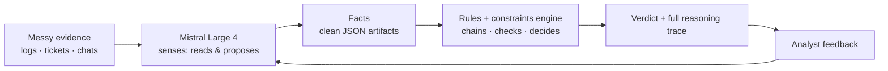
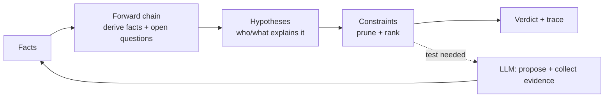
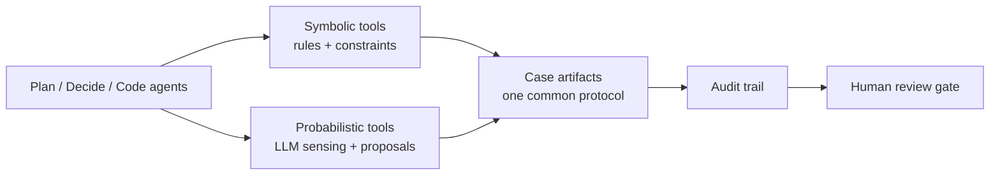

# redyarn — a detective toolkit for messy evidence

*Follow the red yarn, not the red herring.*

**ELI5:** Someone has a mystery and a pile of messy evidence — logs, tickets,
chat messages, receipts. Redyarn turns the evidence into clean facts,
thinks about *who or what could explain the facts*, throws out the
explanations that don't survive the checks, and tells you the most likely
answer — showing its work the whole way, like a detective pinning clues to
a board.

Two halves do the thinking, and they never swap jobs:

- **The senses — Mistral Large 4 (an LLM).** Reads messy evidence and turns
  it into facts, guesses what might explain them, suggests what to check
  next. Probabilistic: great at reading, not at being right.
- **The brain — a rules + constraints engine (plain deterministic code).**
  Chains facts to conclusions, prunes impossible explanations, delivers the
  verdict. Rules always beat vibes.



## The case loop

New facts don't just add conclusions — they open questions: *what else should
I check? what evidence is missing?* The engine keeps a list of open slots and
the senses go fill them. Its favorite trick is cutting the strings that
don't survive the evidence — the Pepe Silvias, the connections with
nothing behind them.



## Agents

Plan / decide / code agents work the case. Each can call both halves, and
they all speak one shared language: the case artifacts (facts, rules,
hypotheses, questions) — the same objects whether they live in files today or
database rows later.



## Domains are packs

Fraud, outages, security findings, contracts — each is a **pack**: an
ontology + rules + constraints. Same engine, different costume. (Sherlock was
a detective, not a doctor — the method is the product.)

## Status: PoC — working end-to-end

One exemplar happy path, end to end, from JSON files and schemas — no
database yet. The exemplar is a classic: **Silver Blaze** — the horse that
vanished and the dog that didn't bark. See
[the PoC plan](docs/discovery/detective-dss-poc.md).

```bash
make dss-demo        # phase 1 — the case as first heard
make dss-demo-2      # phase 2 — the ledger test applied
make dss-selftest    # acceptance test — the happy path, asserted
```

## Where things live

| You want… | Go to |
|---|---|
| The product direction & market reasoning | [docs/discovery/verticals.md](docs/discovery/verticals.md) |
| The architecture decision | [ADR-0003](docs/adr/0003-detective-dss-neurosymbolic-core.md) |
| The PoC plan (case vocabulary) | [docs/discovery/detective-dss-poc.md](docs/discovery/detective-dss-poc.md) |
| The method's history | [docs/vision.md](docs/vision.md) |
| The agent pipeline (how we build packs) | [docs/AGENTIC-RUNTIME.md](docs/AGENTIC-RUNTIME.md), [Makefile](Makefile) |

## Notes

- **Security model (later):** the gondolin micro-VM pipeline is how cases
  with sensitive data get run — agents never see real secrets, only
  placeholders substituted host-side. The PoC runs in the dev session; VM
  isolation is a deployment requirement, not a dev requirement.
- **The SDLC is a future vertical.** This repo started as an agentic SDLC
  framework (proven end-to-end, audited). That machinery is now the *pack
  factory* — and SDLC management itself is a candidate pack, not the
  foundation.
- **Lineage:** the neurosymbolic method comes from
  [docs/vision.md](docs/vision.md) (Reyearn, 2020–2024, Apache-2.0, full
  history imported from
  [chartpath/clientsort-docs-archive](https://github.com/chartpath/clientsort-docs-archive)).
