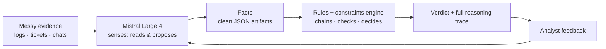
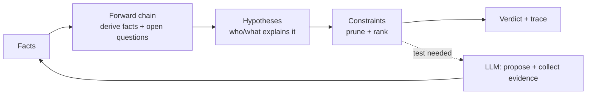
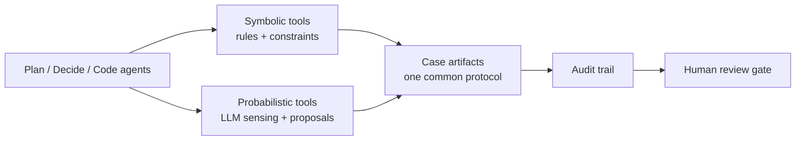

# Facty — a detective toolkit for messy evidence

*Evidence in, verdict out.*

> **Implementation note (ADR-0005):** the primary implementation is the
> **cleanroom stack** in [``]() — TerminusDB as store/schema/
> rule engine (WOQL), SmolVM for isolation, pydantic-ai + Vibe CLI for the LLM
> half, `./facty` as the headless CLI. The original PoC under `engine/` is kept
> as the golden oracle during migration. See [ADR-0005](docs/adr/0005-cleanroom-stack-replaces-poc.md),
> [docs/IMPLEMENTATION.md](docs/IMPLEMENTATION.md), and the methodology mapping +
> triage in [docs/CLEANROOM-METHOD.md](docs/CLEANROOM-METHOD.md).
>
> ```bash
> # quickstart (TerminusDB on :6363 — see compose.yaml)
> ./facty selftest                                        # golden acceptance, all cases
> TERMINUSDB_DB=facty-e2e bash scripts/e2e.sh   # end-to-end demo (offline)
> TERMINUSDB_DB=facty-e2e bash scripts/e2e.sh --live   # with live LLM sensing
> ```

**ELI5:** Someone has a mystery and a pile of messy evidence — logs, tickets,
chat messages, receipts. **Facty** turns the evidence into clean facts,
thinks about *who or what could explain the facts*, throws out the
explanations that don't survive the checks, and tells you the most likely
answer — showing its work the whole way, like a detective pinning clues to a board.

Two halves do the thinking, and they never swap jobs:

- **The senses — Mistral Large 4 (an LLM).** Reads messy evidence and turns
  it into facts, guesses what might explain them, suggests what to check
  next. Probabilistic: great at reading, not at being right.
- **The brain — a rules + constraints engine (plain deterministic code).**
  Chains facts to conclusions, prunes impossible explanations, delivers the
  verdict. Rules always beat vibes.



## The case loop

New facts don't just add conclusions — they open questions: *what else should
I check? what evidence is missing?* The engine keeps a list of open slots and
the senses go fill them. Its favorite trick is cutting the strings that
don't survive the evidence — the Pepe Silvias, the connections with
nothing behind them.



## Agents

Plan / decide / code agents work the case. Each can call both halves, and
they all speak one shared language: the case artifacts (facts, rules,
hypotheses, questions) — the same objects whether they live in files today or
database rows later.



## Domains are bundles

Fraud, outages, security findings, contracts — each is a **pack**: an
ontology + rules + constraints. Same engine, different costume. (Sherlock was
a detective, not a doctor — the method is the product.)

## Why determinism matters

**Determinism is the baseline, not a mode.** The engine always owns the
verdict; the LLM is a tool, never the decision-maker. Liability flows to
humans, not machines.

The 2024 *Moffatt v. Air Canada* case is the canonical example: a chatbot
invented a refund policy, the airline was held liable, and the tribunal
rejected the "the AI is a separate entity" defense. Facty's architecture
makes that failure mode **structurally impossible** — hypotheses come from
the pack, constraints eliminate contradictions, and every verdict is
replayable with a full reasoning trace.

See [docs/PHILOSOPHY.md](docs/PHILOSOPHY.md) for the full stance:
determinism as product, LLM liability, the reverse-centaur warning, and
the human role as knowledge engineer and soundness critic.

## Status: PoC — working end-to-end

Three typed demo cases, end to end, from JSON files and schemas — no
database yet. Each proves the abductive skeleton on a different kind of
judgement (see [docs/INVESTIGATION-TYPES.md](docs/INVESTIGATION-TYPES.md)):

- **attribution** — `attribution-silver-blaze`: the horse that vanished
  and the dog that didn't bark (the classic).
- **adjudication** — `adjudication-phantom-invoice`: a €38,400 invoice
  to a vendor that doesn't exist.
- **causation** — `causation-three-am-outage`: checkout degrades at
  3 a.m. — our deploy, our cert, an attack, or the provider?

The primary interface is the `facty` CLI: bare `./facty` opens the
Textual workbench; the subcommands are the scriptable control plane.

```bash
./facty                  # the workbench (Textual TUI — the primary interface)
./facty cases            # the demo cases (type · pack · phase-2 drop)
./facty run <case>       # run a case (--add-facts <drop> = phase 2 · --json)
./facty selftest         # acceptance test — every case, asserted
./facty test             # all tests: selftest + retry loop + the TUI (headless)
./facty walkthrough <case>   # terminal step-through (VMs, no-TTY)
make deps                # install the optional deps (Textual — the workbench)
```

## Where things live

| You want… | Go to |
|---|---|
| The philosophy (why determinism, liability, human role) | [docs/PHILOSOPHY.md](docs/PHILOSOPHY.md) |
| The product direction & market reasoning | [docs/discovery/verticals.md](docs/discovery/verticals.md) |
| The architecture decision | [ADR-0003](docs/adr/0003-detective-dss-neurosymbolic-core.md) |
| The PoC plan (case vocabulary) | [docs/discovery/detective-dss-poc.md](docs/discovery/detective-dss-poc.md) |
| The investigation types Facty supports | [docs/INVESTIGATION-TYPES.md](docs/INVESTIGATION-TYPES.md) |
| The method's history | [docs/vision.md](docs/vision.md) |
| The agent pipeline (how we build packs) | [docs/AGENTIC-RUNTIME.md](docs/AGENTIC-RUNTIME.md), [Makefile](Makefile) |

## Notes

- **Security model (later):** the gondolin micro-VM pipeline is how cases
  with sensitive data get run — agents never see real secrets, only
  placeholders substituted host-side. The PoC runs in the dev session; VM
  isolation is a deployment requirement, not a dev requirement.
- **The SDLC is a future vertical.** This repo started as an agentic SDLC
  framework (proven end-to-end, audited). That machinery is now the *pack
  factory* — and SDLC management itself is a candidate pack, not the
  foundation.
- **Lineage:** the neurosymbolic method comes from
  [docs/vision.md](docs/vision.md) (the method's philosophical
  foundations).
