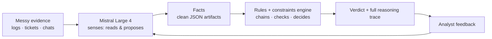
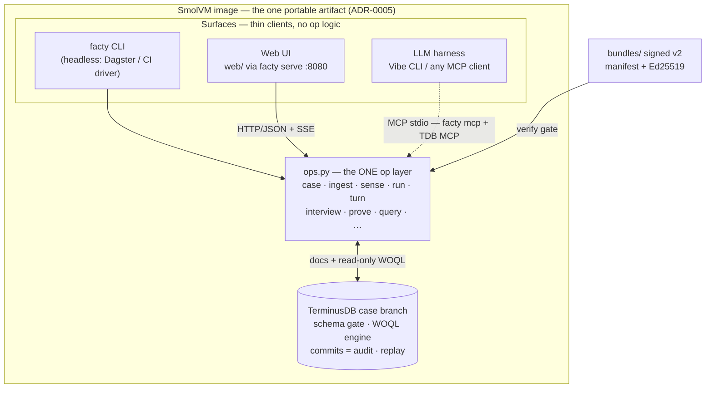
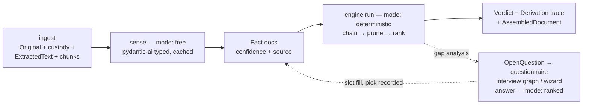

# Facty — a detective toolkit for messy evidence

*Evidence in, verdict out.*

> **Implementation note (ADR-0005):** the implementation is the
> **cleanroom stack** in [`src/facty/`](src/facty) — TerminusDB as store/schema/
> rule engine (WOQL), SmolVM for isolation, pydantic-ai + Vibe CLI for the LLM
> half, `./facty` as the headless CLI and `facty serve` + `web/` as the Web UI.
> The retired PoC's case packs live on as signed bundles in `bundles/`.
> See [ADR-0005](docs/adr/0005-cleanroom-stack-replaces-poc.md),
> [docs/IMPLEMENTATION.md](docs/IMPLEMENTATION.md), and the methodology mapping +
> triage in [docs/CLEANROOM-METHOD.md](docs/CLEANROOM-METHOD.md).
>
> ```bash
> # quickstart (TerminusDB on :6363 — see compose.yaml)
> ./facty selftest                                        # golden acceptance, all cases
> TERMINUSDB_DB=facty-e2e bash scripts/e2e.sh   # end-to-end demo (offline)
> TERMINUSDB_DB=facty-e2e bash scripts/e2e.sh --live   # with live LLM sensing
> ```

**ELI5:** Someone has a mystery and a pile of messy evidence — logs, tickets,
chat messages, receipts. **Facty** turns the evidence into clean facts,
thinks about *who or what could explain the facts*, throws out the
explanations that don't survive the checks, and tells you the most likely
answer — showing its work the whole way, like a detective pinning clues to a board.

Two halves do the thinking, and they never swap jobs:

- **The senses — Mistral Large 4 (an LLM).** Reads messy evidence and turns
  it into facts, guesses what might explain them, suggests what to check
  next. Probabilistic: great at reading, not at being right.
- **The brain — a rules + constraints engine (plain deterministic code).**
  Chains facts to conclusions, prunes impossible explanations, delivers the
  verdict. Rules always beat vibes.



## Execution model (technical readers)

One store, one engine, one signed artifact kind, **one op layer**. TerminusDB
v12.1 is the single database — schema enforced at every write, and its
branch/commit history **is** the audit trail. Every facty operation exists
exactly once in [`src/facty/ops.py`](src/facty/ops.py); all surfaces are thin
clients of it, so they can never diverge (parity by construction, ADR-0010 §4).



Reads vs writes (the ratchet): the LLM's tightest read surface is the
**read-only WOQL passthrough** (`facty query`, `/api/query`, MCP `query` —
write operators in the AST are rejected). **All writes** go through gated ops
that commit typed artifacts with `confidence`+`source`, or signed bundles —
LLM output becomes knowledge only at a gate, never by direct mutation.

## Data flow & the turn model

Evidence in, verdict out — and every step of the run is a committed **turn**
with an explicit determinism mode (ADR-0010 §3):



| Turn mode | Who acts | Replay |
|---|---|---|
| `deterministic` | rules engine over committed state — verdict-path turns are **always** this (ADR-0003) | byte-identical from the branch |
| `ranked` | engine produces the ranked option set (e.g. open questions); human/LLM picks within it; pick recorded in the `Turn` doc | same options + recorded pick |
| `free` | LLM sensing only (facts carry confidence+source) | from the disk cache (`FACTY_SENSE=cache`) |

The questionnaire loop itself is a typed pydantic-graph
([`src/facty/interview.py`](src/facty/interview.py)): gap analysis → ask →
slot-fill → engine run → assemble — no ReAct, no LLM-as-judge; the LLM may act
only in the designated answer-pick node, and every node still commits its
`Turn` doc to the branch (TerminusDB stays the system of record).

Determinism contract: the verdict path (engine) never calls an LLM, a clock, or
a random source — same committed graph state → byte-identical verdict (asserted
by `./facty selftest`). Semantic search (embeddings) is used on the sensing
side and, logged and recorded, for contradiction candidates in the trace — it
never decides anything by itself (ADR-0008/0009).

Agents (the pack factory: plan/decide/code roles) drive the same op layer
through the harness plane — see [docs/AGENTIC-RUNTIME.md](docs/AGENTIC-RUNTIME.md).

## Domains are bundles

Fraud, outages, security findings, contracts — each is a **pack**: an
ontology + rules + constraints. Same engine, different costume. (Sherlock was
a detective, not a doctor — the method is the product.)

**One artifact, three roles.** A knowledge pack, a case's starting pack, and a
demo example are the *same thing*: a signed bundle (`bundles/<name>/`,
Ed25519 manifest per ADR-0006). A case is just a branch created from a bundle
(`facty case init <id> --bundle …`, ADR-0007); a demo is a bundle plus a
starter case branch with fixture evidence. That identity is what makes a
future **marketplace / plugin registry** trivial: a registry is only a
namespace over signed bundle manifests — verify the signature, load, run. No
new artifact kind, no new trust model.

## Why determinism matters

**Determinism is the baseline, not a mode.** The engine always owns the
verdict; the LLM is a tool, never the decision-maker. Liability flows to
humans, not machines.

The 2024 *Moffatt v. Air Canada* case is the canonical example: a chatbot
invented a refund policy, the airline was held liable, and the tribunal
rejected the "the AI is a separate entity" defense. Facty's architecture
makes that failure mode **structurally impossible** — hypotheses come from
the pack, constraints eliminate contradictions, and every verdict is
replayable with a full reasoning trace.

See [docs/PHILOSOPHY.md](docs/PHILOSOPHY.md) for the full stance:
determinism as product, LLM liability, the reverse-centaur warning, and
the human role as knowledge engineer and soundness critic.

## Status: cleanroom stack, working end-to-end

Typed demo cases run end to end on TerminusDB — each proves the abductive
skeleton on a different kind of judgement (see
[docs/INVESTIGATION-TYPES.md](docs/INVESTIGATION-TYPES.md)):

- **attribution** — `attribution-silver-blaze`: the horse that vanished
  and the dog that didn't bark (the classic).
- **adjudication** — `adjudication-phantom-invoice`: a €38,400 invoice
  to a vendor that doesn't exist.
- **causation** — `causation-three-am-outage`: checkout degrades at
  3 a.m. — our deploy, our cert, an attack, or the provider?
- **assembly** — `assembly-unpaid-invoice`: an unpaid-invoice demand
  letter assembled clause by clause (the Web UI demo case).

The interfaces are the `facty` CLI (headless — Dagster/CI driver) and the
Web UI (`facty serve` + `web/`, http://127.0.0.1:8080); both are clients of
the same gateway, so they stay at parity.

```bash
./facty cases            # the signed bundles (packs = case packs = demos)
./facty run <case>       # deterministic verdict on a case branch
./facty serve            # HTTP gateway + Web UI on :8080
./facty selftest         # acceptance test — every case, asserted + replayed
bash scripts/demo-ui.sh  # headless e2e demo of the Web UI flow
make deps                # install the deps (uv sync)
```

## Where things live

| You want… | Go to |
|---|---|
| The philosophy (why determinism, liability, human role) | [docs/PHILOSOPHY.md](docs/PHILOSOPHY.md) |
| The product direction & market reasoning | [docs/discovery/verticals.md](docs/discovery/verticals.md) |
| The architecture decision | [ADR-0003](docs/adr/0003-detective-dss-neurosymbolic-core.md) |
| The PoC plan (case vocabulary) | [docs/discovery/detective-dss-poc.md](docs/discovery/detective-dss-poc.md) |
| The investigation types Facty supports | [docs/INVESTIGATION-TYPES.md](docs/INVESTIGATION-TYPES.md) |
| The method's history | [docs/vision.md](docs/vision.md) |
| The agent pipeline (how we build packs) | [docs/AGENTIC-RUNTIME.md](docs/AGENTIC-RUNTIME.md), [Makefile](Makefile) |

## Notes

- **Security model:** the SmolVM micro-VM is how cases with sensitive data
  get run — agents never see real secrets, only placeholders substituted
  host-side (ADR-0005; the host-secret path is the open item).
- **The SDLC is a future vertical.** This repo started as an agentic SDLC
  framework (proven end-to-end, audited). That machinery is now the *pack
  factory* — and SDLC management itself is a candidate pack, not the
  foundation.
- **Lineage:** the neurosymbolic method comes from
  [docs/vision.md](docs/vision.md) (the method's philosophical
  foundations).
