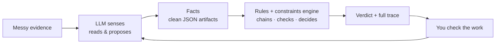
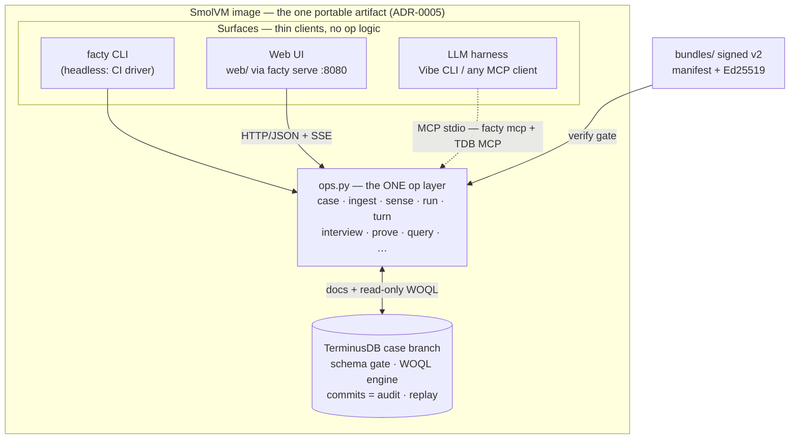

# Facty — a detective toolkit for messy evidence

[](LICENSE)

*Evidence in, verdict out.*

Someone has a mystery and a pile of messy evidence — logs, tickets, receipts,
contracts. **Facty** turns the evidence into clean facts, weighs the possible
explanations, throws out the ones that don't survive the checks, and hands you
the most likely answer **with its full reasoning trace** — like a detective
pinning clues to a board.

Two halves do the thinking, and they never swap jobs:

- **The senses — an LLM (Mistral Large 4).** Reads messy evidence into typed
  facts and proposes what to check next. Probabilistic: great at reading, not
  at being right.
- **The brain — a rules + constraints engine (plain deterministic code).**
  Chains facts to conclusions, prunes impossible explanations, delivers the
  verdict. Rules always beat vibes.



## Quickstart

Needs Docker (TerminusDB on :6363 — `docker compose up -d`) and uv.

```bash
make deps                  # install dependencies
./facty selftest           # acceptance: every signed demo case replays to its expected verdict
bash scripts/demo-ui.sh    # headless end-to-end demo of the Web UI flow
./facty serve              # then open http://127.0.0.1:8080
```

## How it runs

One database (TerminusDB — schema enforced on every write, branch/commit
history *is* the audit trail), one op layer, three thin surfaces that can
never diverge:



Every step of a run is a committed **turn** with an explicit determinism mode
(ADR-0010 §3):

| Turn mode | Who acts | Replay |
|---|---|---|
| `deterministic` | rules engine over committed state — verdict-path turns are **always** this (ADR-0003) | byte-identical from the branch |
| `ranked` | engine produces the ranked options; a human or the LLM picks within them; the pick is recorded in the `Turn` doc | same options + recorded pick |
| `free` | LLM sensing only — facts carry `confidence` + `source` | from the disk cache (`FACTY_SENSE=cache`) |

The questionnaire loop (engine asks, you or the LLM answer) runs as a typed
pydantic-graph — no ReAct loops, no LLM-as-judge; the verdict path never calls
an LLM, a clock, or randomness, so same committed state → byte-identical verdict
(`./facty selftest` asserts this). That's not a preference, it's the product:
in *Moffatt v. Air Canada* a chatbot invented a refund policy and the airline
was held liable — here that failure mode is structurally impossible. See
[docs/PHILOSOPHY.md](docs/PHILOSOPHY.md).

## Demo cases

Each is one **signed bundle** — a knowledge pack, a case's starting pack, and
a demo are the same artifact (`bundles/<name>/`, Ed25519 manifest, ADR-0006).
A case is just a branch created from a bundle (`facty case init <id> --bundle …`).

- **attribution-silver-blaze** — the horse that vanished, and the dog that didn't bark
- **adjudication-phantom-invoice** — a €38,400 invoice to a vendor that doesn't exist
- **causation-three-am-outage** — checkout degrades at 3 a.m.: our deploy, our cert, an attack, or the provider?
- **assembly-unpaid-invoice** — the Web UI demo: an unpaid-invoice demand letter assembled clause by clause

## Everyday commands

```bash
./facty cases                                        # list the signed bundles
./facty case init <id> --bundle bundles/<name>       # new case = new branch
./facty ingest <evidence-dir> --source demo --case <id>   # evidence in, custody tracked
./facty run <case>                                   # deterministic verdict
./facty turn <case> --all                            # run the signed pipeline turn by turn
./facty interview <case>                             # questionnaire loop (pydantic-graph)
./facty query '<woql-json>' --case <id>              # read-only WOQL against the case branch
./facty serve                                        # HTTP gateway + Web UI on :8080
```

## Read more

| You want… | Go to |
|---|---|
| Implementation details & the full roadmap | [docs/IMPLEMENTATION.md](docs/IMPLEMENTATION.md) |
| The neurosymbolic core (why the engine owns the verdict) | [ADR-0003](docs/adr/0003-detective-dss-neurosymbolic-core.md) |
| The cleanroom stack (TerminusDB + SmolVM + Vibe + pydantic-ai) | [ADR-0005](docs/adr/0005-cleanroom-stack-replaces-poc.md) |
| The triadic runtime (harness + Dagster + TerminusDB via MCP, turn modes, parity) | [ADR-0010](docs/adr/0010-triadic-runtime-parity.md) |
| Signed bundles & the trust spine | [ADR-0006](docs/adr/0006-bundle-trust-spine.md) |
| Philosophy: determinism, LLM liability, the human role | [docs/PHILOSOPHY.md](docs/PHILOSOPHY.md) |
| The seven investigation types | [docs/INVESTIGATION-TYPES.md](docs/INVESTIGATION-TYPES.md) |
| Multi-tenant isolation scenarios | [docs/USE-CASES.md](docs/USE-CASES.md) |
| Dependency research log (versions, what was read, divergences) | [docs/research/deps-log.md](docs/research/deps-log.md) |

## Notes

- **Security model:** everything runs in one SmolVM micro-VM; the guest only
  ever sees `MISTRAL_API_KEY=<placeholder>` — the host substitutes real
  secrets into outbound requests to allow-listed hosts only (ADR-0005; the
  host-secret path is the open item).
- **The SDLC machinery in this repo is the pack factory** — how bundles get
  authored and reviewed — not the product's foundation. SDLC management itself
  is a candidate pack.
