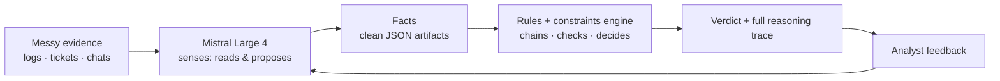
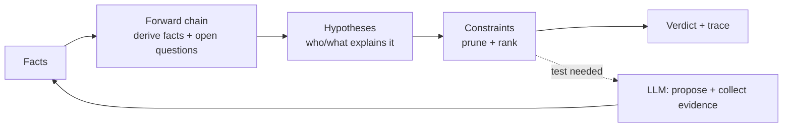
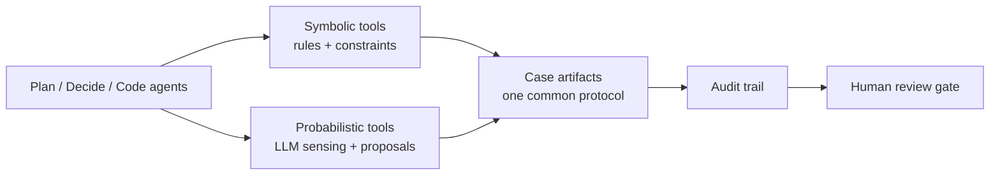

# Architecture Decision Record (ADR)
---

# ADR-0003: Detective DSS — neurosymbolic core (rules + constraints over canonical artifacts, LLM sensing)

**Date:** 2026-10-15
**Status:** accepted
**Deciders:** chart (product owner, session directives 2026-10-15)
**Technical Story:** [docs/discovery/verticals.md](../discovery/verticals.md); continues [PRD-005](../prd/PRD-005-neurosymbolic-bridge.md); lineage [docs/vision.md](../vision.md)
**Product:** Facty — *evidence in, verdict out.*

---

## Context

The framework pivoted from agentic-SDLC infrastructure to a **domain-agnostic
abductive DSS** ("detective DSS"): evidence in → ranked hypotheses with
confidence → discriminating tests → verdict with a full reasoning trace.
Domains are *packs* (ontology + rules + constraints), not code. The SDLC
machinery stays as the pack factory; SDLC management is a future vertical,
not the foundation.

[vision.md](../vision.md) specified this split: the "abductive reasoning
machine" — rules + classifiers held in balance, Rete/CLIPS forward chaining,
backward chaining only sketched via Grakn, and the 2024 LLM-Modulo update:
"LLMs can be swapped with custom classifiers… otherwise the architecture
remains the same"). This ADR is that architecture, modernized, plus the two
things the original only sketched: **backward chaining** and a **constraint
layer**.

**What problem are we solving?**

One reasoning engine that is deterministic where it can be and probabilistic
where it must be — and auditable everywhere.

**Why determinism is the baseline (not a mode):** The 2024 *Moffatt v. Air
Canada* case (2024 BCCRT 149) held an airline liable for a chatbot's
hallucinated refund policy. The tribunal rejected the "the AI is a separate
entity" defense. **Liability flows to humans, not machines.** Facty's
architecture makes that failure mode structurally impossible: the engine
owns the verdict, hypotheses come from the pack, constraints eliminate
contradictions, and every verdict replays with a full trace. See
[docs/PHILOSOPHY.md](../PHILOSOPHY.md) for the full stance.

**What constraints do we have?**

- PoC scope: JSON schemas + objects in files; one exemplar happy path
  end-to-end; no database until one is actually required (Postgres later;
  **no graph database**).
- The PoC is built and tested in the current dev agent session. gondolin VMs
  are a *later* security requirement for real deployments with sensitive
  data/secrets (LLMs must never see them) — not a dev requirement.
- Deterministic symbolic half: forward + backward chaining rules engine with
  constraint-based programming, over the same data types/artifacts,
  persistable as code or JSON DB rows later.
- Probabilistic sensing half: Mistral Large 4, used deeply and maximally.
- Docs: ELI5 front and centre; data flow expressible in ≤3 mermaid diagrams,
  ≤6 boxes each.
- docassemble vocabulary (see [verticals.md](../discovery/verticals.md)): the
  human-as-sensor insight — we swap LLM sensing in.

---

## Decision Drivers

- Determinism where possible (rules beat vibes; verdicts replayable without
  the LLM)
- Auditability as a product feature (the reasoning trace *is* the explanation;
  EU AI Act transparency story)
- One canonical artifact model (the contract); storage is a projection
- Cost: the LLM never sits in the inner loop of rule firing
- Speed to a fun, demo-able exemplar

---

## Considered Options

### Option 1: SPO triples as the starting data structure — rejected for now

Raw subject-predicate-object triples force every consumer to re-derive the
envelope (confidence, source, provenance). **Decision: object form** —
`{id, type, subject, predicate, value, confidence, source, observedAt}` *is*
an SPO triple with an envelope. A triple projection (and JSONB rows) is
trivial later. No triple store.

> **ADR-0005 (2026-10-30) supersedes the runtime/storage options below** (graph
> database is now TerminusDB; runtime is SmolVM + Vibe CLI + pydantic-ai). The
> invariants in §Decision stand unchanged. See
> [ADR-0005](0005-cleanroom-stack-replaces-poc.md) and
> [docs/CLEANROOM-METHOD.md](../CLEANROOM-METHOD.md) for the methodology mapping
> and the triage of not-yet-native reasoning patterns.

### Option 2: graph database — rejected for the PoC

No graph DB. Artifacts are JSON files in the asset graph (diffable,
reviewable, provenance-native). Postgres (JSONB) when a DB is actually
required.

### Option 3: Soufflé / Experta for the rules engine — deferred

A Datalog subset in Python stdlib first (zero new deps in the VM snapshot,
fully deterministic, trivially codegen-able). Soufflé (compiles Datalog to
C++) or Experta (CLIPS-descended) when performance demands.

### Option 4: small typed decider models as the sensing half — demoted

The PO directed Mistral Large 4 as the probabilistic sensing half. Decider
models (GLiDE/Jev/GLiNER class) become optional cheap gates later, not a
core bet.

### Option 5: healthcare-first DSS — declined

Not a target vertical (see [verticals.md](../discovery/verticals.md)).

---

## Decision

### 1. The neurosymbolic split (LLM-Modulo design rule)

**Large 4 senses and proposes. The symbolic engine verifies, chains, and
decides. Rules take precedence over probabilities.** Per the LLM-Modulo
findings vision.md cites: LLMs cannot plan, cannot self-verify, and direct
self-critique doesn't work. The LLM never sits in the inner loop of rule
firing and never issues the verdict; every verdict is a deterministic
artifact the engine can replay without the LLM.

**The symbolic layer is the programmatic soundness critic.** In the original
LLM-Modulo architecture, human soundness critics verify LLM-generated plans.
Facty's rules + constraints layer is that critic, made programmatic —
authored by humans, accountable to humans, improvable by humans. The
soundness of the framework is *derived* from the soundness of the critics
(see [docs/PHILOSOPHY.md](../PHILOSOPHY.md) §3).

**LLMs are tools, not agents.** They can never be conscious, morally
agentic, or legal persons. Liability always flows back to the humans
accountable for the decisions they make, regardless of tool choices. The
LLM senses and proposes; the engine decides; the human owns the
consequence (see [docs/PHILOSOPHY.md](../PHILOSOPHY.md) §2).

**Schema-guided extraction is the sensing contract.** The LLM half's
interface is (JSON schema + messy field input) → typesafe,
schema-validated structured object that the logic engine consumes
(`engine/sensing.py`). Entity extraction and classification are sensing
operations — the engine never extracts or classifies; it verifies what
the senses produce. (PRD-005 GOAL-2 / GOAL-5.) The golden path for the
LLM transport is the **pi agent** (`pi -p`): pi owns the credential (and
its refresh) and the engine process never sees it — the same isolation
posture as the VM host-secret mechanism. A direct Mistral client is
deliberately not used.

**The judge layer with a capped correction loop.** The loop is sense →
judge → solve. The judge validates the structured output (schema +
compute checks on the objects — e.g. unique ids, real source files); a
rejection feeds the error back to the LLM for a capped number of
correction turns (max 3) before the corrected output passes for real.
An unreachable LLM fails fast — that error cannot correct itself.

### 2. Canonical artifact model — one schema, three projections

| Artifact | Canonical JSON shape | Projections |
|---|---|---|
| Fact | `{id, type, subject, predicate, value, confidence, source, observedAt}` | git JSON file (PoC) · JSONB row (Postgres later) · TS type / Datalog fact (codegen) |
| Rule | `{id, version, pack, when:[conds], then:[actions], salience}` | git JSON file · JSONB + versioned table · Datalog / TS / Prolog (codegen) |
| Hypothesis | `{id, statement, status, prior, evidenceFor[], evidenceAgainst[], discriminatingTests[]}` | git JSON file · JSONB |
| Constraint | `{id, type: implies\|mutex\|atLeastOne\|consistentWith, variables[], expression}` | git JSON file · JSONB · CP-SAT model |
| Question | `{id, text, slot, mandatory, status, raisedBy}` | git JSON file · JSONB |
| Derivation | lineage edge `fact ← rule ← facts` | asset-graph edge (existing) |

The schema is the contract; storage and codegen are projections.

### 3. The symbolic engine — three cooperating layers

1. **Forward chaining** (modus ponens): facts fire rules → derived facts.
   Semi-naive Datalog evaluation over a Rete-style index.
2. **Backward chaining** (modus tollens): goal-driven proof per hypothesis; a
   refuted subgoal kills the hypothesis deterministically.
3. **Constraint layer**: hypotheses as CSP variables; constraints prune
   inconsistent explanations (consistency with evidence, mutex, cardinality,
   implication). Propagation for pruning; OR-Tools CP-SAT for ranked search.

**Forward chaining also discovers questions.** Rules' `then` actions emit not
only facts and hypotheses but **Question artifacts** — slots to fill, evidence
to collect, tests to run. New facts make the engine aware of what it doesn't
know (the OST loop inside the engine; docassemble's `reorder` is the same
idea).

### 4. The triad speaks one protocol

Plan / decide / code agent nodes each call **both** tool families. All tools
share a common protocol: the asset artifact types.

| Tool | Half | Input artifacts | Output artifacts |
|---|---|---|---|
| `sense` | probabilistic (Large 4) | raw evidence (files, text) | `fact[]` (schema-valid, confidence + source spans) |
| `propose-hypotheses` | probabilistic (Large 4) | `fact[]`, open questions | `hypothesis[]` (with priors) |
| `propose-test` | probabilistic (Large 4) | `hypothesis`, open questions | `question[]` / evidence requests |
| `explain` | probabilistic (Large 4) | `derivation` | narrative (human-facing) |
| `derive` (forward chain) | symbolic | `fact[]`, `rule[]` | `fact[]`, `question[]`, `hypothesis[]` (fired rules logged) |
| `test` (backward chain) | symbolic | `hypothesis`, `rule[]`, `fact[]` | proven/refuted + subgoal trace |
| `solve` (constraints) | symbolic | `hypothesis[]`, `constraint[]` | ranked `hypothesis[]` (pruned) |
| `combine` (verdict) | symbolic | rule-fired facts + constraint ranking + priors | verdict + `derivation` trace |

### 5. Model wiring

VM + pipeline agents: **mistral-large-4** via the Mistral API host-secret
(confirmed in pi-ai's catalog, `reasoning: true`). The gondolin-pi template
now installs `pi-mistral-subscription` (users can `/login` with a Pro
subscription inside the VM to bill their quotas) and `pi-sandbox` (dev-mode
sandboxing) — both persisted at `/opt/pi-agent`. Interactive host sessions:
`mistral-large-4` via the subscription (settings default).

### 6. Data flow (≤3 diagrams, ≤6 boxes each)

**Two halves:**

**The case loop:**

**Agents & tools (one protocol):**

---

## Consequences

**PoC scope** (see [detective-dss-poc.md](../discovery/detective-dss-poc.md)):
JSON schemas + files; one exemplar happy path — *Silver Blaze* (public
domain, 1892): the horse that vanished and the dog that didn't bark. Built
in the current dev session.

**Demoted:** decider-model layer (optional cheap gates later) ·
SDLC-as-foundation (SDLC is a future vertical) · launchd unattended hosting ·
CI phase triggers · BDD as the product spec format (product specs = schemas +
rule packs + case fixtures).

**Kept:** asset graph, audit trail, VM isolation (deployment security
requirement), git-native pipeline, review gates, self-improvement loop.

**Philosophy:** determinism as baseline and unique value proposition;
LLM liability (no consciousness, no moral agency, no legal personhood);
humans as knowledge engineers and soundness critics; no reverse centaurs
(humans direct machines, not serve them). See
[docs/PHILOSOPHY.md](../PHILOSOPHY.md).

**Spike/assumption framing:** spikes, OST assumptions, acceptance/API
contract tests, and case-based hypotheses are one structure with four names —
the PoC plan uses the case vocabulary.

**Follow-ups:** planner/decider/coder mechanical rename (triad naming ratified
here); AGENTS.md reframing; snapshot rebuild (`gondolin-pi.sh build --force`,
user terminal) to pick up the new template extensions.
