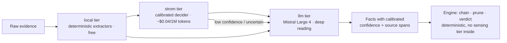

# Cleanroom stack — research & proposal (detective DSS / Pack Studio v2)

**Date:** 2026-10-20
**Status:** draft — PO-directed research; becomes an ADR once the spikes (§10) pass
**Complements:** [ADR-0003](../adr/0003-detective-dss-neurosymbolic-core.md) (its "no graph
database" PoC constraint is **reversed** here — see §1), [PRD-007](../prd/PRD-007-pack-studio.md),
[ARCHITECTURE.md](../ARCHITECTURE.md)

---

## 1. What this is (ELI5)

The PoC proved the concept: evidence in → ranked hypotheses → discriminating
questions → verdict with a full reasoning trace, plus Pack Studio, where the
meta-Facty loop uses the engine's own question generation + an embedded agent
to author knowledge packs from a domain expert. The PoC is a pile of Python
scripts, JSON artifacts, and a Textual TUI with a hand-rolled terminal
emulator (pyte) around pi.

This doc proposes the **cleanroom reimplementation stack**. The rule from the
PO: **capability/feature parity, not API parity** — same outcomes for users
(verdicts, traces, questions, pack authoring), new substrate. No hard
requirement on the PoC's formats (JSON artifacts, W3C/RDF/SHACL) — the LLM
and the engine speak the backend's *native* representations instead.

**Decisions (proposed):**

| Layer | Choice | Why |
|---|---|---|
| Runtime | **One gondolin micro-VM** (`gondolin bash`), whole stack inside | Single sandbox for code + secrets-adjacent work + sensitive case data; host keeps only the key and the browser |
| Language | **TypeScript / Node** | pi and gondolin are already TS with library APIs — the agent runtime, VM control, and store are in-process library calls, one language end to end |
| Store | **LadybugDB** (embedded property graph, openCypher) | Kuzu's actively-maintained successor (MIT); SQL-familiar DDL; single-directory portable store for CI/IaC; `scan/` import; Postgres attach for app state later |
| Query | **openCypher (Ladybug subset)** | Native representation; no projection layer |
| Rules | **Structured rule DSL (JSON) → compiled Cypher** | The LLM never emits Cypher — dialect errors are impossible by construction (§5) |
| Constraints | **In-database Cypher** (ASP tier optional) | The PoC's constraint semantics are expressible in Cypher — no in-memory solver needed for parity (§4.4) |
| Sensing | **3-tier ladder: local → Strom → LLM** | Calibrated cheap scores (System One) gate expensive deep reads (System Two) (§6) |
| Frontend | **Web workbench + xterm.js** over gondolin **ingress** | Real terminal for the pi pane; proper editors/tables/diffs for the rest |
| Secrets | Unchanged: `--host-secret` placeholder + host proxy | See [ARCHITECTURE.md](../ARCHITECTURE.md) |

**Explicitly out:** JVM stacks (Jena/Fuseki, RDF4J, Neo4j, Drools — no real
advantage at this scale), W3C/RDF/OWL/SHACL as a requirement, the PoC's JSON
artifact schemas as a contract.

---

## 2. Why LadybugDB

The PO evaluated KuzuDB earlier and liked its model: embedded, portable in
data pipelines, CI-friendly, IaC-friendly. Research (2026-10-20) confirmed:

- **Kuzu is abandoned** — "abandoned by its creator and sponsor Kùzu."
- **LadybugDB is the successor**: `github.com/LadybugDB/ladybug` ("formerly
  known as Kuzu"), permissive (MIT-style) license, active (v0.18, "Ladybug
  Flying Solo"). Same embedded model: single-directory store, C++ core,
  openCypher.
- **Bindings**: `pip install ladybug`; Node via `@ladybugdb/core`
  (glibc native addon) and **`@lbug/lbug-wasm`** (WASM). The gondolin VM is
  **Alpine (musl)** — the native addon will not load there; the **WASM
  binding** is the in-VM path. (Same musl gap as pyoxigraph, verified on
  PyPI.)
- **SQL-familiar face**: DDL with primary keys is the schema/ontology layer —
  the closest thing to "type assertions" in a property-graph world, and the
  developer audience knows SQL.
- **Data import**: `scan/` (CSV/Parquet/… ingestion) connects evidence sources.
- **Postgres attach** (vendor-documented extension) for traditional
  application state later — graph = knowledge layer, Postgres = app layer.
  Verify in spike #2.

Alternatives considered and set aside: DuckDB + duckpgq (SQL/PGQ — strong
portability, but no schema-as-ontology story), Oxigraph/pyoxigraph (RDF —
rejected with the W3C requirement; also no musl wheels), Zep/Graphiti
(right *temporal model*, wrong deployment shape — Neo4j/FalkorDB/Neptune
backends; adopt the model, not the product, §4.5), TypeDB (server, not
embedded), SurrealDB (multi-model, heavier than needed).

---

## 3. Architecture — everything in one gondolin VM

```
HOST (user's machine)                     GONDOLIN VM (Alpine, one `gondolin bash` session)
┌─────────────────────────┐               ┌────────────────────────────────────────────┐
│  browser                │ HTTP+WebSocket│  facty studio (one Node process)           │
│  localhost:8080         │◄═══ingress═══►│  ├─ web server + workbench UI + xterm.js   │
│  ├─ pack editors, tests │  (gondolin    │  ├─ LadybugDB  (@lbug/lbug-wasm)           │
│  │  runner, trace view  │   --listen)   │  │   └─ rules-as-data, facts, trace         │
│  └─ xterm.js pane ◄─────┼─WebSocket────►│  ├─ rule DSL → Cypher compiler (§5)        │
│     (interactive pi     │               │  ├─ constraint layer in Cypher (§4.4)      │
│      agent; ask_       │               │  ├─ sensing ladder: local→strom→llm (§6)   │
│      questions renders │               │  │   └─ pi SDK (in-process) + Strom client  │
│      natively)         │               │  └─ PTY → pi (interactive pane)            │
│                         │               │  /workspace = repo (rw, mounted)           │
│  real MISTRAL_API_KEY   │               │  MISTRAL_API_KEY = placeholder ────────────┼──► host
│  (held at boot,         │               │  (UPRELIC_API_KEY likewise)                │   proxy
│   host-secret proxy)    │               │                                            │   substitutes
└─────────────────────────┘               └────────────────────────────────────────────┘
```

- **Ingress is the browser pipe.** gondolin's `--listen [HOST:PORT]` starts a
  host ingress gateway that "expose[s] HTTP servers running inside the guest
  VM to the host machine" (documented feature), with **WebSocket upgrades**
  supported on ingress — that's the xterm.js channel. Exact flag mapping is
  spike #1.
- **Boot** (host terminal, holds the key):
  `gondolin bash --listen 127.0.0.1:8080 --mount-hostfs <repo>:/workspace \
    --host-secret MISTRAL_API_KEY@api.mistral.ai --allow-host api.mistral.ai \
    --allow-host registry.npmjs.org -- bash` → inside: `facty studio`.
  A `make studio` wrapper adapts the existing `scripts/vm-session.sh`.
- **The pi pane needs no nested-terminal fix**: pi runs in the *same* VM; the
  Node server bridges WebSocket↔PTY locally. Only the browser hop crosses the
  VM boundary.
- **pi and gondolin as libraries** (verified this research): pi has a real SDK
  — `createAgentSession()` from `@mariozechner/pi-coding-agent` (v0.73.1,
  `docs/sdk.md`) — so sensing ops are in-process calls, no RPC subprocess.
  gondolin is `@earendil-works/gondolin` (v0.13.0), itself a Node script with
  a programmatic API (`import { VM, createHttpHooks } ...`). Same org
  (earendil-works) — one ecosystem, one language.
- **Snapshot**: extend `gondolin/build-snapshot.sh` with the studio's npm deps
  (same pattern as the pi install; build-time egress already includes
  `registry.npmjs.org`). Runtime egress stays the allow-list
  (api.mistral.ai + registry.npmjs.org + api.uprelic.com).
- **Secrets posture unchanged** ([ARCHITECTURE.md](../ARCHITECTURE.md)): real
  key host-side at boot; guest sees placeholders; host proxy substitutes on
  egress. The studio's LLM calls ride the same path today's VM agents use.

---

## 4. The deduction engine on Ladybug

### 4.1 Schema = ontology (SQL-familiar DDL)

The "ontology" the studio builds from natural language is Ladybug DDL:

```cypher
CREATE NODE TABLE Claim(id STRING, amount DOUBLE, status STRING, PRIMARY KEY(id));
CREATE NODE TABLE BankAccount(id STRING, holder STRING, PRIMARY KEY(id));
CREATE REL TABLE FILED(FROM Claim TO BankAccount, filedAt TIMESTAMP);
```

Primary keys give entity resolution; property types give the type assertions
the PoC did with JSON Schema — enforced *by the database*, not by a validator
in front of it.

### 4.2 Rules-as-data

Facts, rules, hypotheses, constraints, and the derivation trace are all graph
nodes/edges. The pack *is* the graph. A verdict's trace is `MATCH`able; no
parallel rule store, no format to keep in sync.

### 4.3 Forward + backward chaining = compiled Cypher

- **Forward chaining**: each rule's `when`/`then` compiles to a Cypher query
  (`MATCH` the conditions → `CREATE`/`MERGE` the derived facts, recording the
  firing rule id on the edge). Iterate to fixpoint. Semi-naive deltas are an
  optimization, not a requirement.
- **Backward chaining**: goal-driven proof per hypothesis — composable
  recursive queries resolving subgoals against the graph; a refuted subgoal
  kills the hypothesis deterministically.
- Composition layer: `@neo4j/cypher-builder` (official, v3.3.0, actively
  maintained) for type-safe Cypher generation, **constrained to Ladybug's
  openCypher subset** (Neo4j Cypher ≠ Ladybug Cypher — verified; the compiler
  only emits supported constructs, §5).

### 4.4 Constraints — in-database, no in-memory solver needed for parity

The shipped PoC constraint layer (`engine/engine.py::apply_constraints`) is
per-hypothesis: **eliminate** = prune when the constraint's conditions match;
**support** = additive score; survivors ranked by score. That is stratified
rule evaluation, expressible as Cypher DML:

```cypher
// eliminate: anti-join prune
MATCH (h:Hypothesis) WHERE NOT (h)-[:CONTRADICTED_BY]->(:Fact {confirmed: true})
SET h.status = 'pruned', h.prunedBy = 'C-eligibility';
// support + ranking: aggregation
MATCH (h:Hypothesis) OPTIONAL MATCH (h)<-[:SUPPORTS]-(f:Fact)
WITH h, count(f) AS support RETURN h ORDER BY h.prior * support DESC;
```

Benefits over the clingo-wasm plan: **one engine** (drop the dependency by
default), prunes are graph writes — the trace records exactly which constraint
killed which hypothesis (**better audit than the PoC**), deterministic,
testable against the golden oracle. `clingo-wasm` (official Potassco WASM,
v0.6.0, maintained) stays as an **optional pack-level escalation tier**
(`solver: cypher | asp`) for future packs needing global combinatorial
optimization (mutex chains, cardinality over explanation sets). A ladder, not
a dependency.

### 4.5 Temporal model (borrowed from Zep/Graphiti)

Adopt Graphiti's semantics over the embedded store: bitemporal edges
(`validAt`/`invalidAt`), episodes, explicit retraction. The DSS is naturally
temporal — facts have `observedAt`; evidence arrives over time; hypotheses
are killed, not deleted. (Graphiti itself: Apache-2.0 temporal KG, but its
backends are Neo4j/FalkorDB/Neptune — server-grade, excluded. Model yes,
product no.)

---

## 5. Durable Cypher-subset guarantee — no retry loop

The PO requirement: generated Cypher must be *guaranteed* to be valid
Ladybug openCypher, with automatic verification or a durable guarantee —
not an LLM retry loop. Answer: make dialect errors **impossible by
construction**, then verify anyway. Three layers:

1. **By construction — the LLM never emits Cypher.** It emits a
   **schema-validated rule DSL** (JSON) over a fixed vocabulary (labels,
   relationship types, operators, aggregations). A **deterministic compiler**
   with a *closed template set* generates the Cypher. If the template set only
   emits Ladybug-supported constructs, every output is valid — composition,
   not generation.
2. **Runtime gate — `EXPLAIN` dry-run.** Every compiled query is `EXPLAIN`ed
   before execution (syntax + semantic validation, no side effects). Kuzu
   supported `EXPLAIN`; verify on Ladybug in spike #2.
3. **CI gate — openCypher TCK.** The compiler's template outputs are tested
   against the openCypher Technology Compatibility Kit
   (opencypher.org/resources) + Ladybug in CI. Tested once; the closed
   template set keeps it true.

Retry loops remain only for **sensing semantics** (fact quality, hypothesis
prose) — never for dialect correctness. Type assertions for the DSL itself:
JSON Schema on the LLM's structured output + the database's own schema
enforcement (property types, primary keys) on write.

---

## 6. Sensing ladder — System One (Strom) + System Two (LLM)



- **Three tiers**: `local` (deterministic extractors — free) → `strom`
  (Uprelic's hosted decision model — calibrated yes/no/choice/score
  probabilities, ~$0.04 per 1M input tokens, 500 req/min, EU/Paris GPUs) →
  `llm` (Mistral Large 4 — deep reading of messy evidence).
- **Strom's calibrated scores become**: fact `confidence` values (the
  artifact model's confidence field, now calibrated and cheap), **escalation
  gates** (low/uncertain → LLM), and **ranking priors**. In the studio's
  authoring loop, Strom pre-scores candidate rules/questions so the LLM
  drafts only the contested ones — the meta-Facty loop gets cheaper per pack.
- **Hard rule (unchanged)**: every sensing tier is **induction-only — never
  in the verdict path**. The engine owns the verdict ([ADR-0003](../adr/0003-detective-dss-neurosymbolic-core.md),
  [PHILOSOPHY.md](../PHILOSOPHY.md)). Strom is an input producer, like the LLM.
- **Existing repo machinery carries over**: `engine/strom.py` (stdlib-only
  client), per-pack drafted decision questions (`sensor/decisions.json`,
  drafted by the LLM, judged, committed), response caching for deterministic
  replay. In the cleanroom: port the client to TS (thin), keep the
  draft-judge-commit pattern for question sets.
- `api.uprelic.com` is already in the VM egress allow-list.
- This generalizes the existing label-sensor ladder
  (`strom` / `hybrid` / `local`) to the whole sensing layer.

---

## 7. Persistence & git-native artifacts

- **Authored artifacts stay text**: DDL (`.cql`) + rule DSL (JSON) + raw case
  evidence — diffable, reviewable; the git-native pipeline and review gates
  are preserved ([GIT-NATIVE-PIPELINE.md](../GIT-NATIVE-PIPELINE.md)).
- **The Ladybug store is the runtime index**: load at start, write-through on
  mutations. The DB directory itself is a portable single artifact (CI/IaC).
- **Interchange**: `scan/` for bulk import; native `COPY ... TO` export for
  snapshots/diffs (verify in spike #2).
- **Audit trail**: derivation = graph edges — queryable via Cypher, exportable.

---

## 8. Invariants carried over from the PoC

- Deterministic verdict path — same graph state → same verdict; no LLM, clock,
  or randomness in it.
- LLM-Modulo split — the engine verifies, chains, prunes, decides; sensing
  tiers (LLM *and* Strom) propose only.
- Auditability as a product feature — the trace is queryable graph data.
- Humans as knowledge engineers and soundness critics; the studio's review
  gates stay.
- Case vocabulary and the meta-Facty loop (Pack Studio dogfooding) — the
  cleanroom's first end-to-end test is authoring a pack with itself.

---

## 9. Research log (verified 2026-10-20)

| Question | Finding |
|---|---|
| KuzuDB status | Abandoned by creator/sponsor; **LadybugDB** is the active MIT successor (v0.18) |
| Ladybug bindings | `pip ladybug`; npm `@ladybugdb/core` (glibc native — **not** for Alpine); `@lbug/lbug-wasm` v0.13.1 (WASM — the in-VM path) |
| pi as a library | SDK mode: `createAgentSession()` (`@mariozechner/pi-coding-agent` v0.73.1, `docs/sdk.md`) |
| gondolin as a library | `@earendil-works/gondolin` v0.13.0 — itself a Node script; `import { VM, createHttpHooks }`; **ingress** (`--listen`) exposes guest HTTP to host, WebSocket upgrades supported |
| TS rules engines | No popular *and* maintained monolith: `nools` (2022), `json-rules-engine` (2025, in-memory JSON only), `dools` (2026, alpha), `rete` (2025, algorithm core), `dmn-js` (2026-10, decision tables — future studio UI), `souffle`/`datalog`/`hylar` npm (2022, stale) → **compose instead** |
| Composition pieces | `@neo4j/cypher-builder` v3.3.0 (2026-05, official) · `clingo-wasm` v0.6.0 (2026-08, official Potassco) |
| Dialect risk | "Why Neo4j Cypher Does Not Run Unchanged in Kuzu" (OneUptime, 2026-08) — constrain to the Ladybug subset |
| openCypher TCK | Cucumber-based compatibility tests for any openCypher implementation (opencypher.org) — CI gate for the compiler templates |
| Zep / Graphiti | Graphiti (Apache-2.0, v0.31.2) = temporal KG; backends Neo4j/FalkorDB/Neptune — adopt the model, not the product |
| TypeDB | Server, not embedded — out on portability |
| DuckDB + duckpgq | Active (SQL/PGQ first-class in DuckDB) — set aside; no schema-as-ontology story |
| RDF stack (prior round) | oxigraph/pyoxigraph/rdflib+owlrl+pySHACL viable but **no musl wheels** for pyoxigraph; W3C set aside per PO |
| Strom | Already in-repo (`engine/strom.py`, `sensor/decisions.json`, response cache, `gondolin/skills/strom`); api.uprelic.com allow-listed |

---

## 10. Spike plan & status

Ordered to derisk the load-bearing assumptions first. **1–3 PASS (2026-10-20).**

1. ✅ **Terminal-native invocation** — tmux layout in one gondolin VM; studio
   TUI pane + pi pane + tests pane; no browser, no pyte. PASS — see
   [spikes/spike-01-terminal-invocation.md](spikes/spike-01-terminal-invocation.md).
   (Re-scoped from "ingress/WebSocket" after the PO directed terminal-first
   invocation; ingress demoted to an optional web view.)
2. ✅ **Ladybug WASM on Alpine** — official `@ladybugdb/wasm-core` in the
   session VM; DDL, CRUD, `EXPLAIN`, `MERGE`, anti-join, ranking, `COPY TO`,
   parameterized queries, disk persistence. PASS — see
   [spikes/spike-02-ladybug-wasm.md](spikes/spike-02-ladybug-wasm.md).
3. ✅ **Rule-DSL → Cypher compiler** — closed-template compiler + `EXPLAIN`
   gate (negative tests included) + forward chaining to fixpoint + trace as
   graph edges + idempotent re-runs. PASS — see
   [spikes/spike-03-rule-compiler.md](spikes/spike-03-rule-compiler.md).
4. ⬜ **Constraint-layer parity** — encode eliminate/support/mutex/cardinality
   in Cypher (§4.4); golden-oracle comparison against the PoC engine on the
   demo cases (same pruning, same ranking).
5. ⬜ **Strom tier** — TS port of the client; sensing ladder on one case;
   measure cost/latency savings and confidence calibration. (Needs an
   ephemeral boot with `--allow-host api.uprelic.com` + the key as a
   host-secret; the long-lived session's allow-list doesn't include it.)

After spikes 4–5: write the ADR (reversal of ADR-0003's graph-DB option, the
TS pivot, the single-VM runtime), then build the cleanroom alongside the PoC
(which stays as the golden oracle).

---

## 11. Ecosystem fits — the LadybugDB org (surveyed 2026-10-20)

The org is active (repos pushed through 2026-10-20). High-leverage projects
and how they fit:

| Project | What it is | Fit for Facty | Recommendation |
|---|---|---|---|
| `mcp-server-ladybug` | MCP server over Ladybug (one `query` tool, result limiting); pip/uvx/docker | The pack-factory **pi agent gets graph tools** (pi supports MCP). The studio already holds the Ladybug connection, so the studio itself can expose an MCP endpoint — fewer moving parts | Studio exposes MCP; keep `mcp-server-ladybug` as the standalone option |
| `ontobug` | Vocabulary/ontology management for RDF: OWL/SHACL/ShEx in named graphs, **Ladybug-backed schema registry**, per-graph scoping, `validate`, drift detection (Rust) | Proves the **schema-registry pattern** on Ladybug. RDF-flavored (no W3C requirement, per PO) — borrow the *pattern* (schemas as queryable graph data, per-pack scoping, validate command, versioning/drift), keep native DDL + rule DSL primary | Pattern yes, product optional (RDF-flavored packs only) |
| `ladybug-skill` | Agent skill: `lbug` shell, language interfaces, Kuzu→Ladybug migration guide | Bake into the VM skill set so the pack-factory agent writes correct Ladybug Cypher | **Add to the snapshot skills** |
| `bugscope` / `bugscope-tauri` | Tauri 2 + sigma.js force-directed graph visualizer for Ladybug; LLM cluster naming | The studio's **trace/explanation view** (visualize the derivation graph); also validates the Tauri direction | Reference, don't adopt (separate desktop app, heavy build) |
| `pg_ladybug` | Postgres extension embedding Ladybug: **Cypher over Postgres tables** (rewritten to SQL JOINs) + standalone Ladybug tables in `$PGDATA` | The "traditional app state" integration (sessions, users, audit in PG, queried via Cypher). PG 17+, needs `liblbug` | Server-tier option; not needed for the embedded studio |
| `ladybug-adbc-python` / `-rs` | Arrow Flight / ADBC columnar server over Ladybug | **Data-pipeline portability**: query the case graph from pandas/Arrow/DuckDB/Flight | Optional export tier |
| `extensions` (repo) | Ladybug's extension catalog: `duckdb`, `ducklake`, `fts` (full-text), `gql` (ISO GQL), `httpfs`, `iceberg`, `adbc`, `algo`, + the **`pg_client` ATTACH extension** | Confirms the PO's "attach postgres" (Ladybug attaching to PG as a catalog). `duckdb` ext = pipeline interop; `fts` = evidence search | `duckdb` + `fts` for the studio; `pg_client` ATTACH for PG app state |
| `bolt4rs` | Bolt protocol (Neo4j driver protocol) in Rust | Ladybug speaks Bolt → Neo4j drivers/tooling can connect | Note; enables Neo4j-ecosystem tools later |
| `ldbc_data_gen_columnar` | LDBC SNB synthetic data generator | Benchmark data for engine scale tests | Use for scale tests |
| `ladybug-fs` | FUSE filesystem view over a graph | Exotic (graph as files) | Note only |
| `rudof` | RDF shapes (SHACL) in Rust | Only if SHACL-lite is ever wanted | Note only |
| `ladybug-nodejs` / `-python` / `-java` / `-rust` / `-dotnet` / `swift-ladybug` | Official native language bindings (glibc) | Native bindings for glibc hosts; **WASM (`@ladybugdb/wasm-core`) for the Alpine VM** | wasm-core in-VM, native on glibc hosts |

---

## 12. Ladybug dialect notes (verified in-VM, 2026-10-20)

These shape the real compiler and the EXPLAIN gate — see
[spikes/spike-03-rule-compiler.md](spikes/spike-03-rule-compiler.md) and
[spikes/spike-02-ladybug-wasm.md](spikes/spike-02-ladybug-wasm.md):

1. String concatenation is `+`; templates compile to segment-joins.
2. `MERGE` patterns can't contain expressions — compute ids in a `WITH`.
3. Multiple `MATCH` patterns are comma-separated.
4. The compiler must use reserved internal variables (`__derived`); rule DSL
   variables may not start with `__` (variable capture).
5. `EXPLAIN` validates syntax **and** semantics (unknown table/label rejected
   at bind time) — a real gate.
6. `conn.query()` **throws** on parse/binder errors — catch, don't rely on
   `isSuccess()` alone.
7. Schema enforcement is at bind time: `SET` on an undeclared property fails —
   declare every property in the DDL (this is the type-assertion behavior).
8. Parameterized queries (`prepare`/`execute` with `$params`) are the
   injection-safe path for LLM-facing input.
9. npm in the VM: disk-backed install paths + `--cache` on disk (tmpfs OOM).
10. The native `@ladybugdb/core` binding is glibc — won't load on Alpine;
    `@ladybugdb/wasm-core` is the in-VM path.
